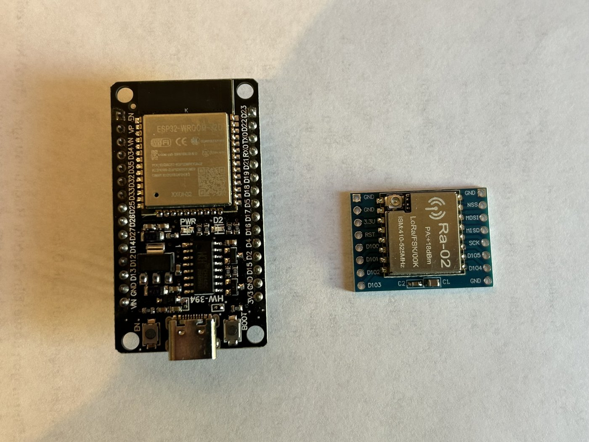
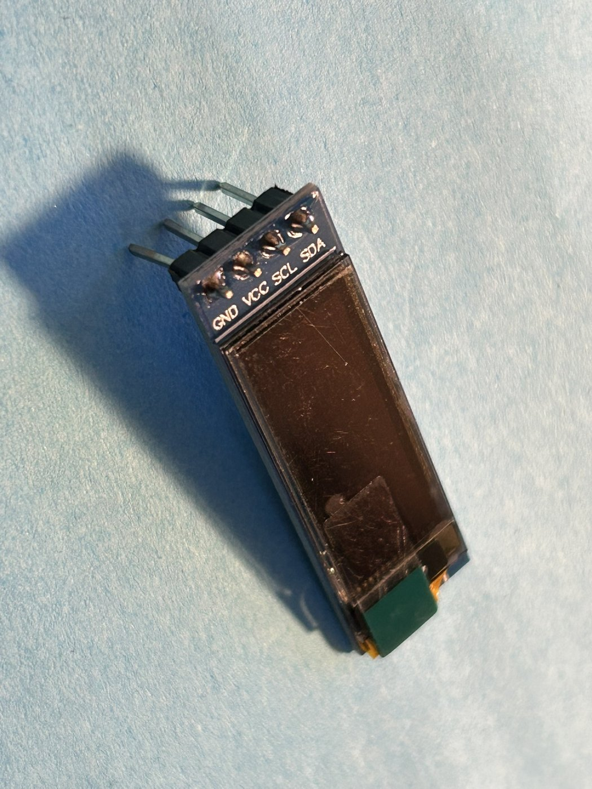
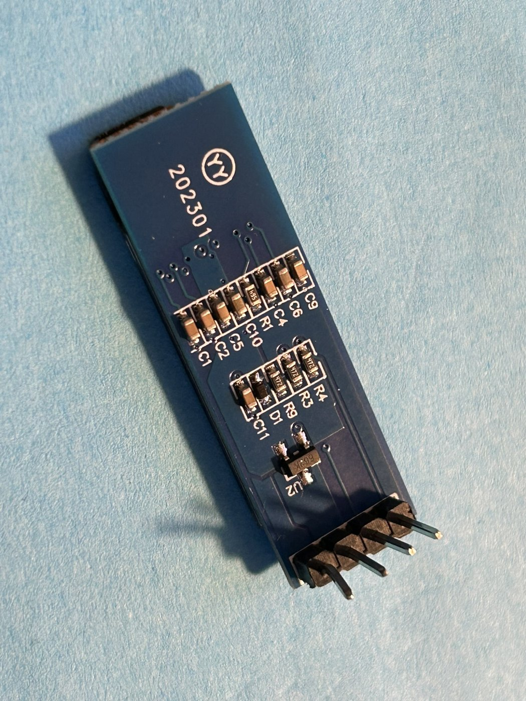

# ESP32-POCSAG: Pager-Empfänger für DAPNET auf 70 cm

Eigenständiger POCSAG-Empfänger für **DAPNET auf 439,9875 MHz** (1200 Bd) mit ESP32, SX1278-Funkmodul
(Ai-Thinker Ra-02) und kleinem I²C-OLED. Der Decoder ist ein plattformunabhängiges C++-Port des
POCSAG-Codecs aus [pluto-tx](https://github.com/jochenhammes/pluto-tx) und läuft auch nativ auf dem PC
(Unit-Tests).



## Status

| Bereich | Stand |
|---|---|
| Decoder (BCH, Sync, Batches, Text) | fertig, 14 native Tests |
| Funkempfang SX1278, Ausgabe als JSON auf Serial | fertig, mit Pluto-Sender getestet |
| OLED-Anzeige und Onboard-LED | fertig |
| Test mit echtem DAPNET-Verkehr | **offen** (ppm-Wert dort ggf. neu abstimmen) |
| Taster, Menü, Einstellungen im Flash, RIC-Filter | geplant (siehe [PLAN.md](PLAN.md)) |

## Funktionen

- Empfang im SX1278-Direktmodus (DIO1 = Bittakt, DIO2 = Daten), Bit-Synchronisation im Chip
- Decoder: Sync-Suche in **beiden Polaritäten**, BCH(31,21) mit **Korrektur von bis zu 2 Bitfehlern**,
  Zusammensetzen von Nachrichten über mehrere Batches, numerisch, alpha und DIN 66003 (deutsche Umlaute)
- Es werden **alle RICs** dekodiert (noch kein Filter)
- Jeder Ruf als **JSON-Zeile** auf Serial (115200 Bd), dazu alle 5 s eine Statuszeile
- **OLED:** bei neuem Ruf einmal weißes Aufblinken, dann der Text einmal in Großschrift durchlaufend,
  danach Kleinanzeige mit RIC, Funktion, RSSI, Alter und seitenweisem Scrollen
- **Onboard-LED:** aus im Ruhezustand, dreimal kurzes Blinken pro erkanntem Ruf
- Serielle Befehle zur Laufzeit: Baudrate, Frequenzkorrektur (ppm), Empfangsbandbreite, Rohbit-Dump

## Hardware

- **ESP32-DevKit** mit ESP32-WROOM-32D (getestet mit „HW-394“, CH340, USB-C)
- **Ra-02** (SX1278, 410–525 MHz). DIO1 und DIO2 müssen herausgeführt sein, das Modul verträgt nur 3,3 V.
  **Die Antenne nicht vergessen**: ohne Antenne kommt praktisch nichts an.
- **OLED** 0,91" I²C, SSD1306, 128×32 (Pins GND, VCC, SCL, SDA)

| Vorderseite | Rückseite |
|---|---|
|  |  |

### Verdrahtung

Alle Pins stehen zentral in [`include/board_config.h`](include/board_config.h).

| Ra-02 (SX1278) | ESP32 | | OLED | ESP32 |
|---|---|---|---|---|
| NSS | GPIO 5 | | SDA | GPIO 21 |
| SCK | GPIO 18 | | SCL | GPIO 22 |
| MISO | GPIO 19 | | VCC | GPIO 16 (siehe unten) |
| MOSI | GPIO 23 | | GND | GPIO 17 (siehe unten) |
| RESET | GPIO 14 | | | |
| DIO0 | GPIO 26 | | Onboard-LED | GPIO 2 |
| DIO1 (DCLK) | GPIO 33 | | | |
| DIO2 (DATA) | GPIO 32 | | | |
| 3,3 V / GND | 3V3 / GND | | | |

**OLED-Versorgung über GPIOs:** Am Aufbau waren keine freien 3V3- und GND-Pins mehr übrig. Deshalb legt die
Firmware GPIO 17 dauerhaft auf LOW (GND) und GPIO 16 auf HIGH (VCC, höchste Treiberstärke). Das reicht für das
kleine Display (wenige mA), ist aber keine saubere Lösung: Der „GND-Pin“ hat einen Innenwiderstand, bei 10 mA fallen
0,3 bis 0,5 V ab. Wenn das Display flackert oder dunkel bleibt, die Versorgung an gemeinsame 3V3/GND-Punkte legen und
in `board_config.h` `PIN_OLED_GND` und `PIN_OLED_VCC` auf `-1` setzen.

Die zweite, rote LED („PWR“) auf dem DevKit hängt fest an der Versorgung und lässt sich nicht abschalten.

## Bauen und Flashen

Voraussetzung ist [PlatformIO](https://platformio.org/) (`pipx install platformio`).

```bash
pio run                                        # nur bauen
pio run -t upload --upload-port /dev/ttyUSB0   # bauen und flashen
pio device monitor -p /dev/ttyUSB0 -b 115200   # Serial-Monitor (Beenden mit Strg+C)
```

Der Port darf beim Flashen nicht von einem Monitor belegt sein. Hängt der Upload bei „Connecting…“, die
BOOT-Taste gedrückt halten.

Anderes Display: Build-Flag in `platformio.ini` ergänzen, `-DDISPLAY_SSD1306_128X64` oder
`-DDISPLAY_SH1106_128X64` (Standard ist SSD1306 128×32).

## Bedienung

### Ausgabe auf Serial

Jeder dekodierte Ruf ist eine JSON-Zeile:

```json
{"t":113836,"ric":1234567,"func":3,"text":"Hallo DAPNET Test","bits":140,"corrected":0,"bad":0,"inverted":true,"baud":1200,"rssi":-73.0}
```

| Feld | Bedeutung |
|---|---|
| `t` | Uptime in ms |
| `ric`, `func` | Adresse und Funktionsbits (0–3) |
| `text` | Nachricht als UTF-8. Funktion 0 gilt als numerisch, sonst alpha. Immer als DIN 66003 dargestellt |
| `bits` | Länge der Nutzdaten |
| `corrected` | korrigierte Bits im Ruf |
| `bad` | nicht korrigierbare Codewörter („beschädigt“) |
| `inverted` | Polarität des empfangenen Signals |
| `rssi` | Feldstärke in dBm beim Rufende |

Alle 5 s kommt `{"status":{...}}` mit Batches, Codewort-Zählern (`cw_ok`, `cw_bad`), Lock-Status,
RSSI (aktuell und Spitze), Baudrate und ppm. Nur die Rufe ohne Status zeigt:

```bash
pio device monitor -p /dev/ttyUSB0 -b 115200 | grep --line-buffered '"ric"'
```

### Serielle Befehle

Zeilenweise eingeben, mit Enter abschließen.

| Befehl | Wirkung |
|---|---|
| `status` | Statuszeile sofort ausgeben |
| `baud 512` / `1200` / `2400` | Baudrate umstellen (der Chip demoduliert immer nur eine) |
| `ppm <x>` | Frequenzkorrektur setzen, positiv = Modul läuft zu hoch |
| `bw <kHz>` | Empfangsbandbreite (Tabellenwert des SX127x, Standard 20,8) |
| `raw on` / `raw off` | Rohbits als `R <64 Bit>`-Zeilen ausgeben (Debug) |
| `reg <hex>` / `reg <hex> <hex>` | SX127x-Register lesen / schreiben (Debug) |

Die Werte gelten bis zum nächsten Neustart. Dauerhaft eingestellt wird in `board_config.h`.

### Anzeige und LED

- **OLED im Ruhezustand:** Frequenz, Baudrate, RSSI, „LOCK“, Batches, Zähler der Rufe
- **Neuer Ruf:** Aufblinken (250 ms), Großschrift-Laufschrift (80 px/s), danach Kleinanzeige: Kopfzeile
  `RIC F<Funktion> <RSSI> <Alter>` und drei Textzeilen mit je 25 Zeichen. Längere Texte wechseln alle 3 s die Seite
  (`n/m` in der Kopfzeile). Ein `!` markiert Rufe mit beschädigten Codewörtern.
- Tempo und Dauer der Animation stehen in `board_config.h` (`UI_*`).
- **LED (GPIO 2):** dreimal kurz blinken pro Ruf (`LED_BLINK_*`)

## Frequenzabstimmung (ppm)

Die Quarze billiger SX1278-Module sind ungenau (typisch ±10–20 ppm, das sind bei 440 MHz **±4–9 kHz**).
**1 ppm entspricht bei 439,9875 MHz etwa 440 Hz.** Der Demodulator im Direktmodus schaltet nur um, solange der
Sender weniger als die Hubweite (4,5 kHz) neben der Empfangsmitte liegt. Das nutzbare Fenster ist deshalb nur
rund **±8 ppm** breit. Liegt der Sender außerhalb, bleibt der Datenausgang konstant auf 0 oder 1 hängen, und es
kommt kein Ruf durch. Ein breiterer Empfangsfilter hilft dagegen nicht.

Standardwert: `FREQ_CORRECTION_PPM = -12` in [`include/board_config.h`](include/board_config.h). Er wurde mit
dem Pluto als Sender gemessen und gilt für genau dieses Modul. Echte DAPNET-Sender haben einen eigenen Fehler.
Abstimmen:

1. Mit `ppm <x>` im Serial-Monitor verschiedene Werte durchprobieren (z. B. -30 bis +10 in 4er-Schritten) und
   beobachten, bei welchen Werten Rufe ankommen.
2. Fenster ausmessen und den Wert in die Mitte legen.
3. In `board_config.h` eintragen und neu flashen.

Mit einem **unmodulierten Träger** (z. B. `pluto-cli tx fm` mit stiller WAV) und `raw on` kann man die Mitte
genau finden: Der Datenausgang kippt von 0 auf 1, wo die Empfangsmitte auf dem Träger liegt.

## Tests

### Native Unit-Tests (ohne Hardware)

```bash
pio test -e native
```

14 Tests: BCH-Korrektur (alle 1- und 2-Bit-Fehler), Codewörter gegen die Python-Referenz, Text (alpha, numerisch,
Umlaute), Dekodieren aller Testvektoren, invertierte Polarität, Rauschpräfix, Bitfehler, reines Rauschen,
Phantomrufe nach Sendeende, mehrere Rufe hintereinander, lange Nachrichten über mehrere Batches.

Die Testvektoren (`test/test_pocsag/vectors.h`) werden mit [`tools/gen_vectors.py`](tools/gen_vectors.py) aus
pluto-tx erzeugt (`python3 tools/gen_vectors.py /pfad/zu/plutosdr`). pluto-tx wird dabei nur gelesen.

### Funktest mit Pluto als Sender

Mit `pluto-cli` aus pluto-tx, **bewusst mit geringer Leistung** (hier 40 dB Dämpfung, die beiden Antennen nahe
beieinander, besser noch mit Dämpfungsglied). DAPNET-Frequenz, nur kurze Testrufe:

```bash
pluto-cli tx pocsag --device pluto --freq 439987500 --power-ceiling -40 --power -40 \
  --ric 1234567 --kind alpha --function 3 --text "Hallo DAPNET Test" --baud 1200 --charset de --yes
```

Hinweise: `pluto-cli` lehnt Nachrichten über 120 Zeichen ab. `--charset de` sendet Umlaute als DIN 66003.
Die Sendeleistung immer stufenweise steigern, nie mehr als nötig.

## Architektur

```
SX1278 (FSK, Continuous Mode, Bit-Synchronizer)
   │ DIO1 = DCLK (steigende Flanke)   DIO2 = DATA
   ▼
ISR: Bit lesen → Ringpuffer (lock-free, 4096 Bit)
   ▼
loop(): BatchDecoder.pushBit()   ← Port von pocsag_codec.py
   │  Sync-Suche in beiden Polaritäten, Batch-Verfolgung, BCH-Korrektur
   ▼
Rufe → JSON auf Serial  +  OLED (Flash, Laufschrift, Seiten)  +  LED
```

Wichtige Entscheidungen:

- **Eigener Decoder statt RadioLib `PagerClient`:** der hat keine BCH-Korrektur und nur eine Polarität.
  RadioLib wird nur zur Chip-Konfiguration benutzt.
- **Neue Adressen nur mit höchstens einem korrigierten Bit** (nach einem verpassten Sync nur fehlerfrei), sonst
  entstehen aus Rauschen Phantomrufe: ein zufälliges 32-Bit-Wort liegt mit ~26 % Wahrscheinlichkeit innerhalb
  von zwei Bitfehlern eines gültigen Codeworts.
- **RSSI per Register (`0x11`) lesen**, nicht mit `getRSSI()`: das schaltet den Chip um und stoppt den Bittakt.

## Projektstruktur

```
platformio.ini            env:esp32dev (Firmware), env:native (Unit-Tests)
include/board_config.h    Pins, Displaytyp, ppm, LED- und Animationswerte
lib/pocsag/               bch, batch_decoder, text (ohne Arduino-Abhängigkeit)
src/main.cpp              Setup, Hauptschleife, JSON-Ausgabe, serielle Befehle, LED
src/radio.{h,cpp}         SX1278-Konfiguration, DCLK-ISR, Ringpuffer
src/ui.{h,cpp}            OLED (U8g2), Animation, Kleinanzeige
test/test_pocsag/         Unity-Tests (nativ) und generierte Testvektoren
tools/gen_vectors.py      Testvektoren aus pluto-tx
docs/images/              Fotos
PLAN.md                   Projektplan und Recherche
```

## Bekannte Einschränkungen

- Eine Baudrate gleichzeitig (Standard 1200 Bd), kein Scan über 512/1200/2400
- ppm und Baudrate sind nur zur Laufzeit per Serial änderbar und werden nicht im Flash gespeichert
- Automatische Frequenznachführung (AFC) fehlt. Der Fehler muss von Hand abgeglichen werden. Der FEI-Wert
  des Chips folgt der Ablage zwar, springt aber um etwa 8 kHz zwischen den beiden Seiten der Empfangsmitte
- Kein RIC-Filter, keine Taster, kein Menü
- Text immer als DIN 66003. Sender mit reinem ASCII zeigen `[ \ ] { | } ~` als Umlaute
- Nachrichten länger als 120 Zeichen konnten live nicht mit `pluto-cli` getestet werden (nur nativ bis 300 Zeichen)

## Rechtliches

DAPNET ist ein Amateurfunknetz, das Empfangen ist unproblematisch. **Fremde Funkrufnetze (BOS, e\*Message usw.)
dürfen in Deutschland nicht abgehört und deren Inhalte nicht weitergegeben werden.** Dieses Projekt ist für
DAPNET auf 439,9875 MHz gedacht. Wer sendet (z. B. zum Testen), braucht dafür ein Amateurfunkzeugnis und
beachtet die Betriebsregeln.

## Quellen

- [pluto-tx](https://github.com/jochenhammes/pluto-tx): POCSAG-Codec (Vorlage für den Decoder) und Testsender
- [RadioLib](https://github.com/jgromes/RadioLib): Ansteuerung des SX1278
- [U8g2](https://github.com/olikraus/u8g2): OLED-Treiber
- ITU-R M.584: POCSAG
